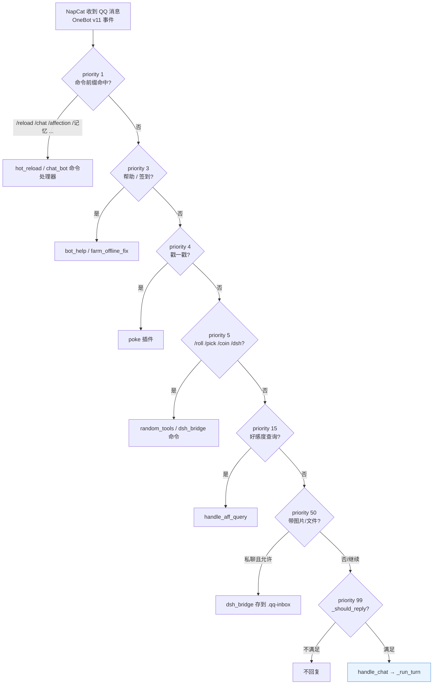
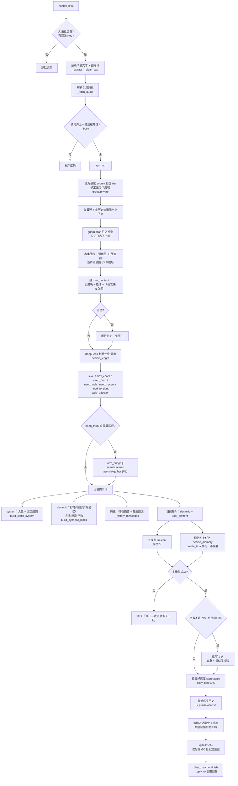
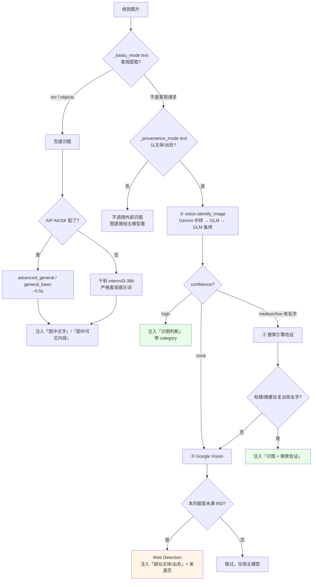
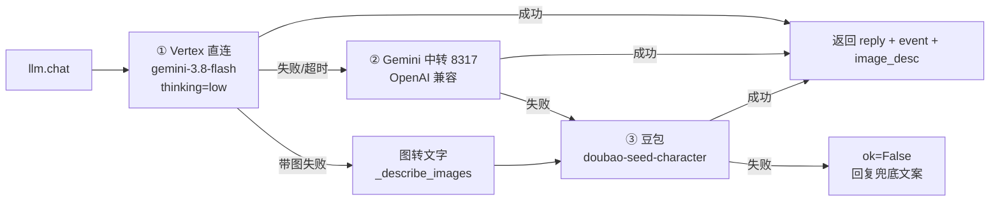

# QQ 机器人聊天流程图（若娜瓦）

> 对应代码：`D:\dshex\qqbot`（NoneBot2 + NapCat/OneBot v11）
> 更新时间：2026-10-19。图中「优先级」是 NoneBot matcher priority，数字越小越先跑。

---

## 一、消息分发（谁先接这条消息）



`_should_reply()` 的四个条件（`__init__.py` L962）：

1. 群在 `CHAT_ENABLED_GROUPS` 白名单里（或留空=全部）
2. 不是命令（不以命令前缀开头，避免抢 `/钓鱼`、`/开通农场`）
3. 私聊：看 `CHAT_PRIVATE_ENABLED`
4. 群聊：必须 `@` 机器人（`event.is_tome()`）

---

## 二、主流程（handle_chat → _run_turn）



---

## 三、图片分支（三路识图）



补充规则：

- 图片**不预先转文字**给主模型，Gemini 原生看图（省一次调用、也看得更准）
- 只有 Gemini 带图失败时，才走 `_describe_images` 把图转成文字，再用豆包重试
- 引用图如果下载失败，也走 `_describe_images` 兜底
- Google Vision 每月硬上限 950 次（免费 1000，预留 50），本地计数、到顶不联网

---

## 四、主模型降级链



- 输出是 JSON：`reply` / `event`（none/praise/offense）/ `reason` / `image_desc`
- 超时 90s，实测 Vertex 3~9s

---

## 五、状态与持久化

| 数据 | 文件 | 写入时机 |
| --- | --- | --- |
| 好感度分值 | `state/chat_affection.json` | 每轮 `store.apply`（praise/offense 另记历史） |
| 好感度事件 | `state/affection_history.jsonl` | 仅夸赞/冒犯 |
| 对话历史 | `state/chat_history.json` | 每轮追加；≥120 条后台归档压缩 |
| 长期记忆 | `state/chat_memory.json` | 好感 >50 且 DeepSeek 判定值得记 |
| 人设 | `plugins/chat_bot/persona.toml` | 启动/热重载时加载，12 档 |
| Google 额度 | `state/vision_quota.json` | 每次调用前 +1，按月归零 |
| 百度 token | `state/baidu_token.json` | 首次取 token 后缓存 25 天 |

---

## 六、纯文本速览

```
QQ 消息
  │
  ├─ 命令前缀? ──→ 各命令插件（priority 1~5）
  ├─ 帮助/签到/戳一戳/roll … ──→ 对应插件
  ├─ 带附件(私聊) ──→ dsh_bridge 存 .qq-inbox
  └─ @机器人（群）或私聊 ──→ chat_bot
        │
        ├─ 解析文本 / 图片 / 引用
        ├─ 图片分支：
        │    客观提取（读字/列内容）→ 百度
        │    认主体/出处 → 识图判断 → 搜索佐证 → Google（兜底）
        │    其他 → 不调外部，图直接给 Gemini
        ├─ DeepSeek 判长度 + 是否要农场/联网
        ├─ 农场数据 ∥ 联网搜索（并行）
        ├─ 组装：人设(system) + 动态块 + 历史 + 本轮
        ├─ 主模型：Vertex → Gemini 代理 → 豆包
        ├─ 续写（不足 70% 时补 1 次）
        ├─ 好感度结算 + 历史/记忆落盘
        └─ 引用回复
```
